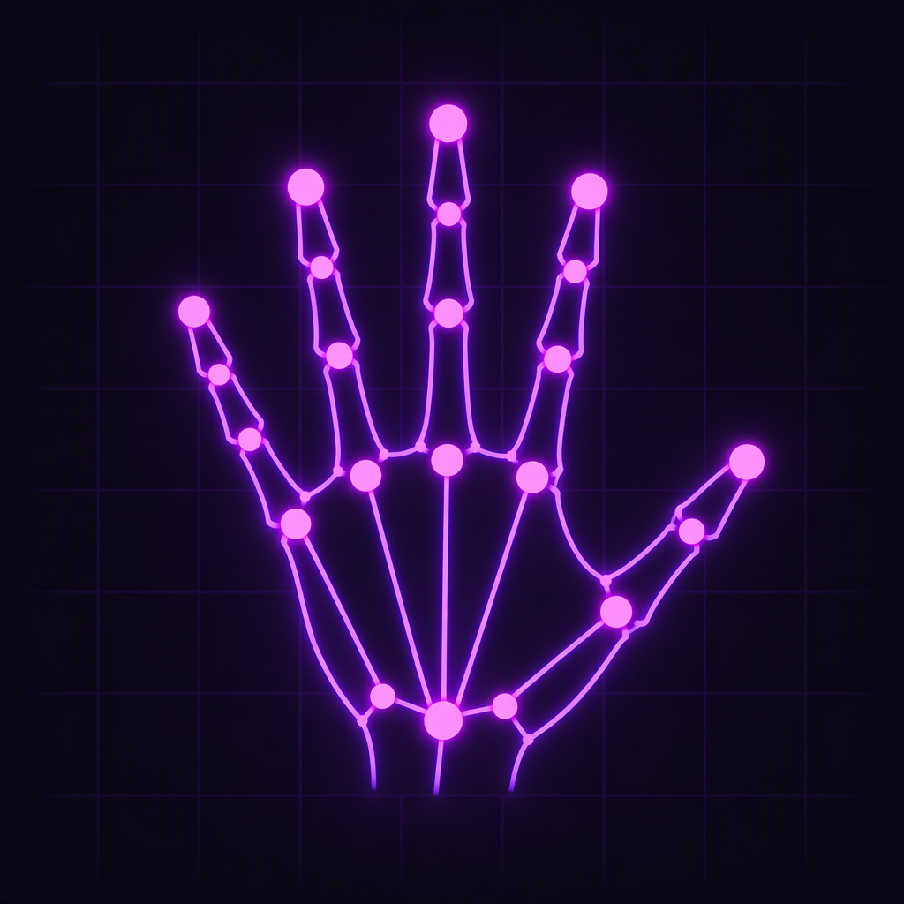
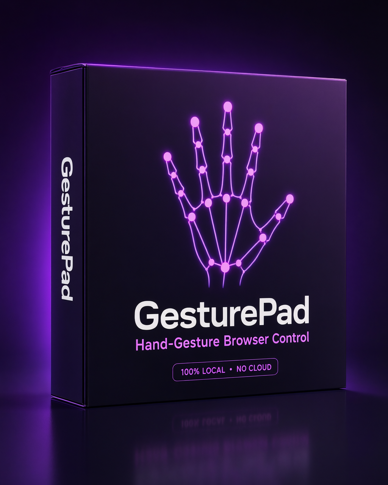
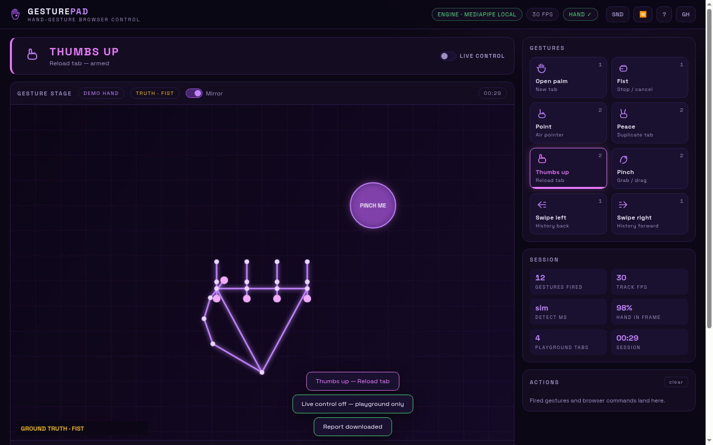
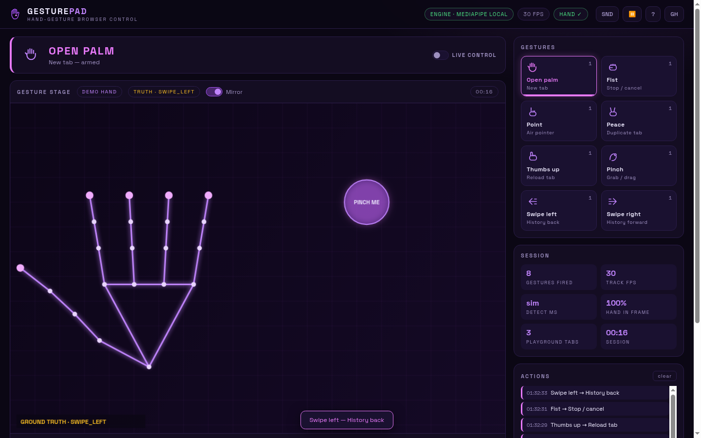
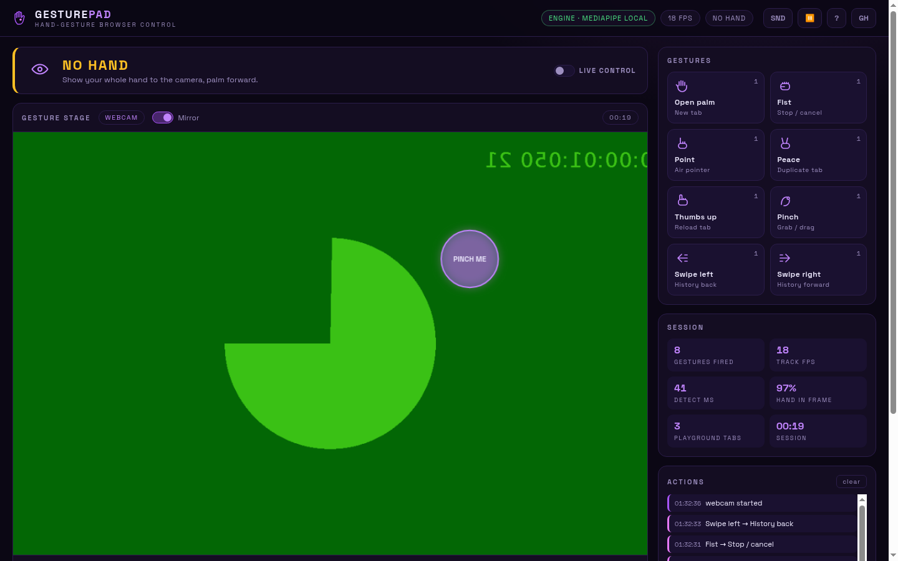
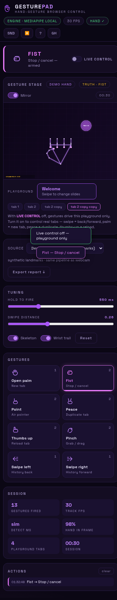

# GesturePad — Hand-Gesture Browser Control

<p align="center">
  
</p>

**Wave, pinch, swipe — your hand becomes the mouse.** GesturePad turns your webcam into a
touchless controller: it tracks 21 hand landmarks with MediaPipe, classifies 8 gestures with a
pure-geometry engine, and can drive real browser actions (back, forward, reload, new tab,
duplicate, tab cycling) — all running 100% locally.

No video ever leaves your machine. The only permission is `storage` (to remember your tuning).

<p align="center">
  
</p>



---

## The 8 gestures

| Gesture | Pictogram meaning | Playground action | Live browser action |
|---|---|---|---|
| Open palm | all five fingers extended | new tab chip appears | opens a new tab |
| Fist | everything curled | halt — releases a grabbed orb | nothing (safe no-op) |
| Point | index only | green pointer follows your fingertip | nothing (pointer mode) |
| Peace | index + middle | duplicates the slide card | duplicates the current tab |
| Thumbs up | thumb up, fingers curled | reload flash on the card | reloads the current tab |
| Pinch | thumb + index held **away from palm** | grabs & drags the violet orb | nothing (grab mode) |
| Swipe left | open hand moving left fast | previous slide | go back in history |
| Swipe right | open hand moving right fast | next slide | go forward in history |

Static gestures are **hold-to-fire**: keep the pose for ~550 ms (tunable 300–1200 ms) and it
fires **once per pose entry** — holding a thumbs-up for 10 seconds reloads exactly once.

## Live Control — real actions, deliberately limited

The **LIVE CONTROL** toggle is off by default. When on, fired gestures are forwarded to the
background service worker, which calls `chrome.tabs` APIs on the tab you were last focused on:

- `chrome.tabs.goBack / goForward / reload / duplicate / create / update`
- **Never acts on GesturePad's own tab** — the worker checks the sender and skips itself.
- **Cannot close tabs, cannot read page content, cannot navigate to arbitrary URLs.**
  The manifest requests only `storage`; tab operations are limited to what the `tabs` API
  exposes without host permissions (no titles, no URLs, no scripting).
- Tab cycling (next/prev) picks the neighbouring tab in the same window.

This is a safety design, not a missing feature: a hand tremor should never be able to close
your work or open arbitrary sites.

## How classification works (no ML classifier — just geometry)

MediaPipe HandLandmarker outputs 21 normalized landmarks. Everything after that is
deterministic math in `js/gestures.js`:

- **Finger extended**: `dist(tip, wrist) > dist(pip, wrist) × 1.06` **and** the
  MCP→PIP / PIP→TIP direction cosine > 0.35 (rejects half-curled fingers that happen to
  reach far).
- **Thumb extended**: `dist(tip₄, pinkyMCP₁₇) > dist(ip₃, pinkyMCP₁₇) × 1.12`
  (thumb abduction measured across the palm — rotation invariant).
- **Pinch**: thumb–index distance < 0.32 × hand size **and** the pinch midpoint is held
  **> 1.0 × hand size from the wrist**. This second rule was the key fix: in a fist the
  curled thumb naturally rests against the curled index (distance ≈ 0.14!), so distance
  alone misreads every fist as a pinch. Requiring the pinch to be *presented away from the
  palm* separates them cleanly (pinch ≈ 1.44 vs fist ≈ 0.89 hand-sizes).
- **Stability**: 5-frame majority vote (≥ 3 of last 5) before a pose is accepted.
- **Swipes**: wrist-position trail, `|dx| > 0.26` (tunable 0.15–0.45) with
  `|dx| > 1.6 × |dy|`, inside an adaptive time window. The trail is **reset on every pose
  change**, so the transition motion into/out of a pose can't dilute or fake a swipe.
- **Adaptive window**: background tabs are throttled to ~1 Hz by Chrome. A fixed 420 ms
  swipe window can never collect 2 samples at 1 Hz, so the window scales with the measured
  frame interval: `max(420, min(3000, 2.5 × dtEma))`. Honest trade-off: at 1 Hz true swipe
  *velocity* is unmeasurable — a slow drift can register as a swipe in a background tab.
  Static hold gestures are unaffected.

## Demo mode — a procedurally animated hand

No camera? The built-in demo synthesizes a full 21-landmark hand and runs a 16.4 s scripted
routine through all 8 gestures, rendered as a glowing skeleton with ground-truth badges.
It exercises the *same* classifier as the webcam path — nothing is faked or short-circuited.
The scripted swipes deliberately start moving only **after** the pose transition settles
(240 ms crossfade), mirroring how a real user forms a pose then moves.



## Webcam mode

960×640 capture, mirrored by default (natural "mirror" interaction), CPU delegate
(~40 ms/frame on a typical laptop, ~19–30 fps UI). The video frame is drawn to canvas and
landmarks are overlaid — frames are never uploaded, stored, or recorded.



## Features

- Gesture console: per-gesture cards with SVG pictograms, armed/hold progress bar, fire flash, live counts
- Playground: slide deck + tab chips so every action has visible feedback without Live Control
- Tuning panel: hold time, swipe distance, mirror, skeleton overlay, wrist trail, sound — persisted in `chrome.storage.local`
- Session stats: gestures fired, fps, hand-presence %, per-gesture breakdown
- Actions log + exportable session report (JSON download)
- Pause veil (freezes detection, releases camera indicator state), help modal
- Marimba-style WebAudio blips (no audio assets)
- Responsive down to 375 px



## Privacy

- Camera frames are processed in-page by vendored MediaPipe WASM. **Zero network calls** at runtime — the model, WASM, and fonts are all bundled.
- No analytics, no telemetry, no accounts.
- `storage` persists tuning sliders only.
- Live Control performs tab operations only when explicitly toggled on.

## Honest limits

- One hand at a time (`numHands: 1`) — chosen for stable single-hand control.
- Geometry classifier is tuned for a right/left hand facing the camera; extreme roll or
  fingers pointing at the camera degrade extension tests.
- Background-tab throttling (~1 Hz) makes swipe velocity unmeasurable; the adaptive window
  keeps swipes *possible* but less precise. Keep the tab visible for best results.
- CPU delegate prioritizes compatibility over speed; ~40 ms/frame is typical.
- Fist is intentionally a no-op in Live Control.

## Install (unpacked)

1. Clone or download this folder.
2. `chrome://extensions` → Developer mode → **Load unpacked** → select the folder.
3. Click the toolbar icon — GesturePad opens as a full tab. Try demo mode first, then webcam.

## Test harness

End-to-end tests run real Chromium (headful under `xvfb-run`) with the extension loaded via
`--load-extension`, fake camera via `--use-fake-device-for-media-stream`, and puppeteer-core.
Latest run — all green:

| Check | Result |
|---|---|
| Engine init (MediaPipe WASM, CPU) | ready, no errors |
| Demo cycle: all 8 gestures | each fired exactly 1×, total 8, 30 fps |
| Swipe left / right (offline calibration, dt 33–50 ms × 3 phases) | 3/3 and 3/3 |
| Playground state | tabs `[tab 1, tab 2, tab 2 copy]`, swipes cancel to slide 0 |
| Tuning | hold 300 ms applied, reset to 550 ms |
| Pause | frame counter frozen |
| Webcam pipeline | 19 fps, ~41 ms detect, correct NO HAND state on test pattern |
| Live Control | real `reload` executed on the focused foreign tab, never own tab |
| Log / report / help | pass |
| Mobile 390 px | scrollWidth 375 ≤ 390, no overflow |
| Console errors | none |

## Repo layout

```
manifest.json      MV3, storage-only, wasm-unsafe-eval CSP
background.js      toolbar click → app tab; gp-command tab operations (self-guarded)
app.html           full-tab console UI
css/app.css        violet theme, Space Grotesk (bundled woff2)
js/gestures.js     geometry classifier + GestureEngine (hold/swipe/cooldown)
js/hands.js        MediaPipe HandLandmarker wrapper (CPU, VIDEO mode)
js/demo.js         procedural 21-point hand + 16.4 s scripted routine
js/sources.js      webcam source
js/audio.js        WebAudio blips
js/app.js          orchestration, rendering, playground, live control, stats
vendor/            tasks-vision bundle, WASM, hand_landmarker.task model
icons/ docs/ promo/
```

## Promo kit

| Asset | File |
|---|---|
| Logo | `promo/logo.png` |
| Software box | `promo/software-box.png` |
| Poster | `promo/poster.png` |
| Banner | `promo/banner.png` |
| Video (8 s, 1080p) | `promo/promo.mp4` |

## Credits & licenses

- Code: MIT (see `LICENSE`).
- [MediaPipe Tasks Vision](https://github.com/google-ai-edge/mediapipe) (`vendor/vision_bundle.mjs`, WASM): Apache-2.0.
- Hand Landmarker model (`vendor/hand_landmarker.task`): Apache-2.0, Google.
- [Space Grotesk](https://fonts.google.com/specimen/Space+Grotesk) font: SIL OFL 1.1.
- All demo hands are procedurally generated; no real person appears in any asset.